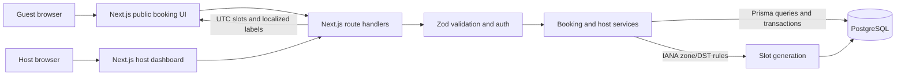

# Slotbook architecture

## Components

- `src/app`: App Router pages and JSON route handlers.
- `src/components`: booking, management, host-cancellation, and login UI.
- `src/lib/booking.ts`: timezone-aware slot generation and active-capacity conflict rules.
- `src/lib/booking-service.ts`: transaction boundaries and booking state transitions.
- `src/lib/auth.ts`: password helpers, signed host sessions, and deterministic private management tokens.
- `src/lib/db.ts`: the shared Prisma client.
- `prisma/schema.prisma` and `prisma/migrations`: normalized PostgreSQL schema and initial migration.

## Architecture and booking request flow

The guest browser requests public slots, then submits a hold to the route handler. The handler validates the request and delegates to the booking service, which locks the shared host calendar and event row, checks capacity/conflicts, and commits the hold and notification record in PostgreSQL. Confirmation, rescheduling, and cancellation use the same database-backed lifecycle; the response gives the guest a private management link.

## Booking request flow

1. The guest requests a bounded date range from `GET /api/hosts/{host}/events/{slug}/slots`. The server validates the guest IANA timezone, loads host-local weekly hours and date overrides, reads active holds using database time, and returns UTC instants with guest-local labels.
2. The guest posts a selected UTC instant and guest details to `POST /api/holds`.
3. If an idempotency key is present, the transaction inserts or locks its unique database record first. A matching completed request replays the original booking reference; different request content returns `409`.
4. The transaction first locks the owning `Host` row with `SELECT ... FOR UPDATE`, then locks the `EventType` row. It validates the current schedule, checks same-event capacity and host-wide conflicts with active bookings from other event types, then inserts the hold.
5. PostgreSQL sets expiry with `clock_timestamp() + INTERVAL '5 minutes'`. The transaction also writes the hold notification. The private token is derived from the booking UUID using the server secret; only its SHA-256 hash is stored in `Booking`.
6. Confirmation locks the host, event, and booking rows in that order, checks expiry and revalidates the host-wide calendar before changing the hold to confirmed. The state transition and notification are atomic; an expired hold is marked `expired`, and a calendar conflict returns `409`.
7. Rescheduling locks the host, event, and booking rows in that order, checks the target schedule, same-event capacity, and cross-event conflicts excluding the booking being moved, then updates its interval and notification in one transaction. A failure leaves the original interval untouched.
8. Guest and host cancellation use the same host → event → booking row-lock order and atomically mark the booking cancelled with a reason and notification.

## Database design and constraints

The schema separates `Host`, `EventType`, `AvailabilityRule`, `AvailabilityOverride`, `Booking`, `IdempotencyKey`, and `Notification`. Foreign keys cascade from host/event records. Unique constraints cover host email/slug, event slug per host, one date override per event, management-token hashes, and idempotency keys.

The initial SQL migration additionally enforces event duration, capacity, buffer, weekday, minute-window, booking interval, and held-booking-expiry constraints. PostgreSQL timestamps are `TIMESTAMPTZ`; local override dates use `DATE`.

## Locking and capacity correctness

The host row is the shared scheduling-resource lock. Every operation that can create or change a booking's active interval acquires it inside its PostgreSQL transaction before touching event or booking rows. Hold creation then locks the event row and, after checking the event's seat capacity, scans active host bookings for conflicts with other event types. Confirmation takes the same locks and repeats the cross-event check before converting a hold to a confirmed booking. Rescheduling holds the host lock while checking and updating the target interval, so it releases the old interval only if the new one can be reserved. Guest and host cancellations use the same lock order and release the interval transactionally.

The consistent lifecycle lock order is **host → event type → booking**. Hold creation first locks its unique idempotency record, then follows that order; no other path acquires an idempotency lock after a host lock. Consequently, distinct event types for one host cannot race past one another, while operations for separate hosts can proceed independently. The event lock remains in place for per-event capacity, so group events still admit up to their configured capacity. Host-calendar checks exclude bookings for the candidate's own event type (handled by the capacity check), but compare all other event types using each booking's stored interval and its own event-type buffers alongside the candidate's buffers.

Confirmed bookings and unexpired holds consume the shared host calendar. Expired and cancelled rows are excluded using database-time expiry checks. Public slot listings apply the same cross-event conflict rule as a convenience; `POST /api/holds`, confirmation, and rescheduling recheck inside the locking transaction and remain authoritative. No JavaScript mutex or external locking service participates in correctness.

The PostgreSQL integration suite in `tests/integration` covers same-event capacity, simultaneous cross-event holds, non-overlapping event types, active/expired/cancelled holds, cross-event rescheduling, confirmation conflict detection, idempotent retries, expiry, and cancellation. `npm run test:integration` requires `E2E_DATABASE_URL` to target a dedicated test database distinct from `DATABASE_URL`; it migrates the retained `slotbook_integration` schema and never resets or truncates data. The latest recorded run passed all 27 integration tests against the isolated Docker PostgreSQL database.

## Time-zone and DST policy

The host timezone is an IANA identifier. Weekly rules are stored as wall-clock minutes within a local weekday, and override dates are stored as PostgreSQL `DATE`. Slot starts are resolved in the host zone; slot start/end instants are returned and persisted in UTC.

For daylight-saving transitions, a nonexistent local start is omitted. A repeated/ambiguous local start is also omitted rather than silently selecting one of its two possible offsets. A nonexistent availability-window end is shifted forward according to Luxon's gap normalization; an ambiguous window end uses the later occurrence so the declared window includes the repeated interval. Slot duration itself is elapsed time, not assumed local-clock arithmetic.

Example: in `America/New_York`, on 2026-03-08 the clock jumps from 01:59 EST to 03:00 EDT. A 02:15 local start does not exist and is not offered. A 03:00 start is persisted as `2026-03-08T07:00:00Z`.

## Authentication and private links

Passwords use bcrypt. The host cookie contains a host ID and expiry signed with `AUTH_SECRET` and is marked HTTP-only, SameSite=Lax, and Secure in production. Management links use a keyed HMAC token derived from the unpredictable booking UUID; the database stores only a SHA-256 hash and indexes it uniquely. Rotating `AUTH_SECRET` invalidates existing sessions and management links, so production secret rotation requires a planned migration strategy.

## Reliability and limitations

- API payloads are validated with Zod; conflicting slots and idempotency-key reuse produce explicit `409` responses.
- Booking transitions and notification records share the same transaction.
- Notifications are persisted in PostgreSQL only. No email delivery is claimed.
- Unit tests cover isolated scheduling, buffers, capacity semantics, host-calendar conflict rules, DST, and signed-token behavior. The latest unit run passed 32 tests; the 27 database integration tests are excluded/skipped by that runner and are run separately.
- Host-side event/availability CRUD and profile settings are implemented in the dashboard and protected APIs.
- PostgreSQL integration and Playwright E2E tests require a separately configured `E2E_DATABASE_URL` and refuse to fall back to `DATABASE_URL`. The latest recorded integration run passed 27 tests; the latest Playwright run passed all 15 tests across Chromium, Firefox, and WebKit. Their schemas are separate and retained; tests clean only their owned records.
