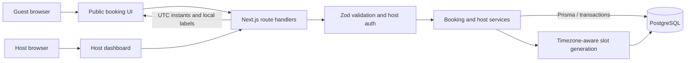

# Slotbook submission report

> Submission status: this is the Markdown source for the required report. It must be exported as a 6–12 page PDF or an 8–15 slide deck after the public repository URL is available.

## 1. Links and project overview

- Public GitHub repository: pending creation; add the actual URL before sending this report.
- Live URL: not deployed.

Slotbook is a host-and-guest appointment scheduling application. Hosts configure event types, weekly availability, date overrides, profile details, and review/cancel upcoming bookings. Guests browse public availability, create and confirm a temporary hold, and manage confirmed appointments through a private link.

## 2. Architecture

The application uses Next.js App Router pages and route handlers, React, strict TypeScript, Tailwind CSS, Prisma, and PostgreSQL. API routes validate input and call business logic in `src/lib`; PostgreSQL is the source of truth.

The guest requests available slots, selects a UTC instant, and requests a hold. The route validates the request and the service rechecks schedule, capacity, and host-calendar conflicts inside a PostgreSQL transaction. Confirmation and subsequent management operations use the same persistence boundary. See [docs/ARCHITECTURE.md](./ARCHITECTURE.md) for the detailed flow and lock order.

## 3. Data model

| Table | Purpose and important constraints |
|---|---|
| `Host` | Host identity, unique email/slug, password hash, and IANA timezone. |
| `EventType` | Host-owned event configuration: duration, capacity, buffers, notice, horizon; unique slug per host. |
| `AvailabilityRule` | Host-local recurring weekday windows; indexed by event and weekday. |
| `AvailabilityOverride` | Date-specific closure or custom hours; unique per event/local date. |
| `Booking` | UTC start/end, lifecycle status, guest details, expiry, cancellation reason, and management-token hash; foreign keys and indexes support ownership and conflict queries. |
| `IdempotencyKey` | Unique request key, request hash, and stored result for replay-safe hold creation. |
| `Notification` | Booking-linked lifecycle event and payload, committed with the transition. |

The initial SQL migration adds relational constraints, indexes, uniqueness constraints, and check constraints. PostgreSQL timestamps are `TIMESTAMPTZ`; local override dates use `DATE`.

## 4. Key decisions and alternatives

1. **PostgreSQL as the concurrency authority.** A JavaScript mutex would only coordinate one process, and Redis would add an external correctness dependency. The host row lock serializes mutations across event types in the database itself.
2. **Host → event → booking lock order.** Event-only locks allow cross-event overlaps. A shared host lock prevents that race; a stable order reduces deadlock risk. Idempotency is locked before these rows only on hold creation, and no path acquires it afterward.
3. **Database time for hold expiration.** Application clocks can drift between app instances. Expiry is calculated from PostgreSQL `clock_timestamp()` and capacity checks compare against database time.
4. **Persist idempotency results with the booking.** An in-memory cache loses results on restart and cannot serialize concurrent requests. A unique database key and transaction ensure the same request replays one result.
5. **UTC instants plus host-local schedule rules.** Storing wall-clock booking timestamps makes cross-zone comparisons unreliable. Schedules use IANA local time, while appointments persist as UTC instants; guests receive localized labels.
6. **Explicit DST gap/fold policy.** Silently shifting a nonexistent time or choosing one repeated time can surprise guests. Nonexistent and ambiguous slot starts are omitted; tests cover both transitions.
7. **Private management token with hashed storage.** Storing a raw bearer token increases database exposure impact. The database stores a hash, while the private link authorizes guest management and scoped self-excluding availability.
8. **Transactional notification sink instead of email integration.** The assignment requires an event sink, not a delivery vendor. Database notification records commit atomically with state changes and keep external delivery out of the core path.

## 5. Booking lifecycle and reliability

Lifecycle: `held → confirmed → cancelled`; a hold can become `expired`. Holds expire exactly five minutes after the database timestamp. Active unexpired holds and confirmed bookings consume capacity; expired and cancelled bookings do not.

| Failure/race | Protection | Test evidence |
|---|---|---|
| Two requests exceed one-to-one or group capacity | Event row lock and transactional capacity recheck | PostgreSQL integration tests for concurrent capacity-one and limited group holds. |
| Different event types overlap on the same host | Host row lock and host-wide conflict check | PostgreSQL tests for simultaneous overlaps, non-overlaps, holds, cancellation, confirmation, and cross-event rescheduling. |
| Same idempotency key is retried concurrently | Unique database key plus transactional stored response | PostgreSQL integration test for concurrent same-key retry. |
| Confirmation arrives after hold expiry | Database-time expiry check | Integration test verifies late confirmation is rejected and capacity released. |
| Reschedule target is unavailable | Check and interval update in one transaction | Integration tests verify failed move preserves original booking and competing moves serialize. |
| DST changes invalidate a local time | Explicit omission policy for gaps/folds | Unit test covers spring-forward and fall-back transitions. |
| Public availability is manipulated to exclude another booking | Server validates management token and matches event/booking | Integration test verifies correct token works and invalid/mismatched token is rejected. |

## 6. Time zones and DST example

Weekly availability is expressed as wall-clock time in the host's IANA zone; overrides use local calendar dates. Appointment starts and ends are stored as UTC instants. Guests can select their display zone; public availability does not return guest names, emails, or booking IDs.

For `America/New_York` on 2026-03-08, clocks jump from 01:59 EST to 03:00 EDT. A 02:15 local start does not exist and is not offered. A 03:00 local start is stored as `2026-03-08T07:00:00Z`. During the fall-back repeated hour, ambiguous slot starts are omitted instead of choosing an offset silently.

## 7. API and testing

The documented API covers public slots; hold creation with `Idempotency-Key`; hold confirmation; private guest reschedule/cancel; host login/logout; event CRUD; profile, weekly availability, overrides; and host cancellation.

| Check | Latest actual result |
|---|---|
| Unit tests | 32 passed; PostgreSQL-only tests are skipped by the unit runner. |
| PostgreSQL integration | 27 passed against isolated schema `slotbook_integration`. |
| Playwright E2E | 15 passed across Chromium, Firefox, and WebKit (five per project). |
| Combined `npm run test:all` | Passed: unit, all 27 PostgreSQL integration tests, and all 15 Playwright tests. |
| ESLint | Passed. |
| TypeScript `npx tsc --noEmit` | Passed. |
| Production build | Passed. |

The suites use `slotbook_test` on port 5434 with separate retained integration and E2E schemas. Runners reject falling back to the development database, and they do not reset or truncate it. `npm run test:all` runs unit, integration (including real-PostgreSQL concurrency), and E2E suites sequentially. No load test was run, so no throughput, p95, or error-rate numbers are claimed.

During final verification, an initial multi-browser attempt intermittently reported `ECONNRESET` on the test's final concurrent idempotency requests. Server logs showed both requests had completed with the expected 201/200 responses. The E2E harness now uses separate request contexts for independent concurrent clients and reads their bodies before disposing the contexts. The targeted flow then passed in all three browsers and the final full `test:all` run passed; booking transactions and assertions were not weakened.

## 8. Optional extensions

- **Built:** Playwright end-to-end guest/host flows and cross-browser runs (the assignment's combined E2E-and-CI extension is partial because GitHub Actions CI is not configured).
- **Not built:** waitlist, reminders, calendar invites, host webhooks, round-robin teams, external busy times, daily caps/per-guest limits, load testing, CI, rate limiting/bot protection, live deployment, embeddable widget, and formal screen-reader audit.
- Notification sink records are implemented; actual email delivery is out of scope and not claimed.

## 9. AI usage

AI assistance supported repository inspection, implementation, test authoring, Playwright debugging, and documentation. Prompt themes included auditing the assignment, protecting host-wide availability under concurrency, using a dedicated PostgreSQL test database, fixing observed E2E failures, and comparing the final project with the original PDF.

The earlier audit incorrectly treated pnpm, dashboard sidebar navigation, and shadcn/Lucide usage as required and said the original PDF was unavailable. Direct inspection of the supplied PDF showed these are not core requirements; this report and requirements matrix correct that interpretation. Playwright failures were inspected through traces/screenshots and corrected without weakening assertions or changing booking transactions. Final test results are listed above; no AI-generated result is reported as passed without an executed run.

## 10. Known gaps and next steps

1. Create the public GitHub repository and preserve the existing incremental commit history; then add its actual link above.
2. Export this reviewed report to the assignment's 6–12 page PDF or 8–15 slide format, including the architecture diagram and repository link.
3. Confirm whether an external starter template was used and name it in `README.md`, or explicitly state that none was used.
4. `docker compose up` starts only the isolated PostgreSQL test service, not the Next.js application. `npm run dev:bootstrap` runs migrations, seeds, and starts the app against an already-running database. Keep this explicit database-only setup unless the submission owner chooses a different deployment/run model.
5. No live deployment, CI workflow, abuse rate limits, email delivery, or load-test measurements are claimed. Add them only if desired; they are not core scheduling requirements.
